<!-- Hand-built animated SVGs with transparent backgrounds, in a dark and a light set (assets/dark, assets/light);
     <picture> shows the one that matches the visitor's GitHub theme. To update them, edit tools/build.py and run: python3 tools/build.py -->

<a href="https://theomkargharge.github.io/Portfolio/">
  <picture>
    <source media="(prefers-color-scheme: light)" srcset="assets/light/hero.svg" />
    
  </picture>
</a>

  <a href="https://theomkargharge.github.io/Portfolio/"><picture><source media="(prefers-color-scheme: light)" srcset="assets/light/btn-portfolio.svg" /></picture></a>&nbsp;
  <a href="https://www.linkedin.com/in/omkargharge/"><picture><source media="(prefers-color-scheme: light)" srcset="assets/light/btn-linkedin.svg" /></picture></a>&nbsp;
  <a href="https://theomkargharge.github.io/Portfolio/Omkar_Gharge_Resume.pdf"><picture><source media="(prefers-color-scheme: light)" srcset="assets/light/btn-resume.svg" /></picture></a>&nbsp;
  <a href="mailto:omkarghargeog@gmail.com"><picture><source media="(prefers-color-scheme: light)" srcset="assets/light/btn-email.svg" /></picture></a>&nbsp;
  <a href="https://leetcode.com/IAmOm45/"><picture><source media="(prefers-color-scheme: light)" srcset="assets/light/btn-leetcode.svg" /></picture></a>

 

<picture>
  <source media="(prefers-color-scheme: light)" srcset="assets/light/about.svg" />
  
</picture>

  

<picture>
  <source media="(prefers-color-scheme: light)" srcset="assets/light/experience.svg" />
  
</picture>

  

<a href="https://play.google.com/store/apps/details?id=com.akbartravel.AkbarTravels&hl=en_IN">
  <picture>
    <source media="(prefers-color-scheme: light)" srcset="assets/light/work-akbar.svg" />
    
  </picture>
</a>

  

  <a href="https://play.google.com/store/apps/details?id=com.crazzydev.tryware.dev"><picture><source media="(prefers-color-scheme: light)" srcset="assets/light/work-tryware.svg" /></picture></a>
  <a href="https://play.google.com/store/apps/details?id=com.buggy"><picture><source media="(prefers-color-scheme: light)" srcset="assets/light/work-buggy.svg" /></picture></a>

 

<a href="https://github.com/theomkargharge/performance_guard">
  <picture>
    <source media="(prefers-color-scheme: light)" srcset="assets/light/work-perf.svg" />
    
  </picture>
</a>

  

<picture>
  <source media="(prefers-color-scheme: light)" srcset="assets/light/stack.svg" />
  
</picture>

  

<a href="mailto:omkarghargeog@gmail.com">
  <picture>
    <source media="(prefers-color-scheme: light)" srcset="assets/light/footer.svg" />
    
  </picture>
</a>

  

